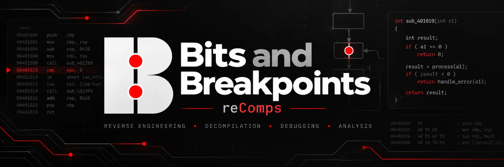

<p align="center"><strong>Classic games, recompiled for today. Easy to play, with optional enhancements, for everyone.</strong></p>

# Roll Away PC port

A native Windows version of the PlayStation game **Roll Away** (Psygnosis,
1998), known in Europe as **Kula World** and in Japan as **KulaQuest**
(Sony Computer Entertainment; developed by Game Design Sweden AB). All three
releases are supported. The game's own code is recompiled to run natively on
Windows, with no emulator and no BIOS, and the port adds sharper graphics, a
pause menu and a number of quality-of-life improvements.

**You need your own copy of the game.** The port reads the graphics, sound,
music, movies, text and data from a disc image that you make from your own
original disc.

<table align="center">
  <tr>
    <td align="center">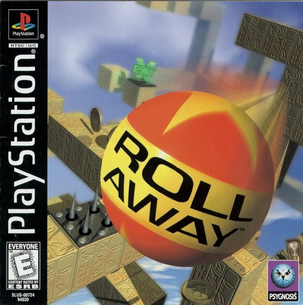</td>
    <td align="center">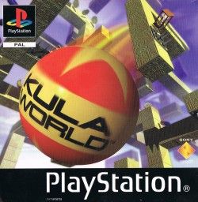</td>
    <td align="center">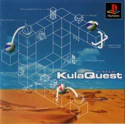</td>
  </tr>
  <tr>
    <td align="center"><strong>Roll Away</strong><br>USA, SLUS-00724</td>
    <td align="center"><strong>Kula World</strong><br>Europe, SCES-01000</td>
    <td align="center"><strong>KulaQuest</strong><br>Japan, SCPS-10064</td>
  </tr>
</table>

<p align="center"><em>The releases this port plays: any one of them is enough. Covers © their respective owners.</em></p>

## Download

**[⬇ Download the latest release (roll-away-pc.zip)](https://github.com/Bitsandbreakpoints/roll-away-psx-pc-recomp/releases/latest/download/roll-away-pc.zip)**

All releases are on the [Releases page](https://github.com/Bitsandbreakpoints/roll-away-psx-pc-recomp/releases).

1. Download `roll-away-pc.zip` and unzip it anywhere.
2. Start `roll_away.exe` (Windows 10 or later; no installation).
3. Click **CHOOSE DISC** and pick your disc image, or drop it on the window.
   `.bin`/`.cue` and `.chd` work (an `.iso` works too, but without music
   and movies: it holds no XA sectors). The launcher checks that the image
   is *Roll Away (USA)*, *Kula World (Europe)* or *KulaQuest (Japan)*, and
   which of them.
4. Click **PLAY**.

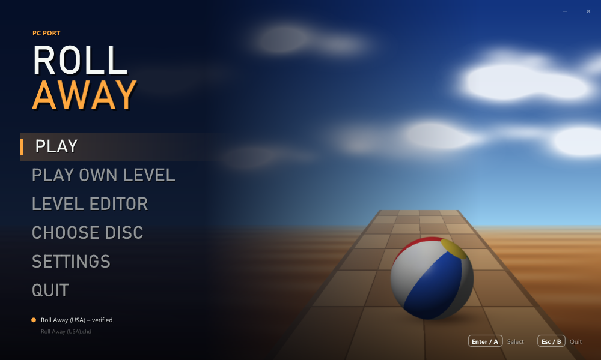

## Pictures

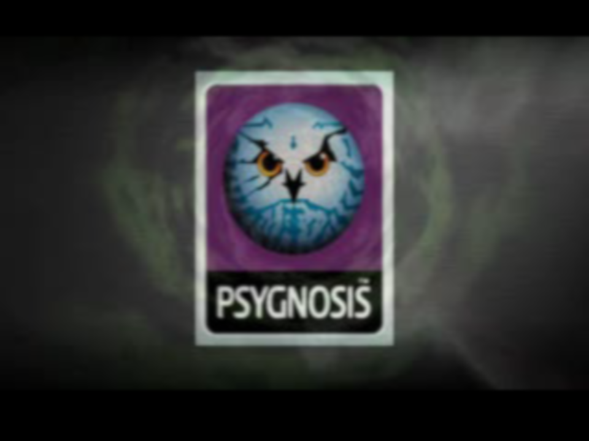

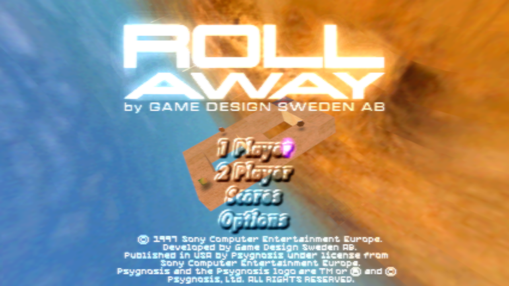

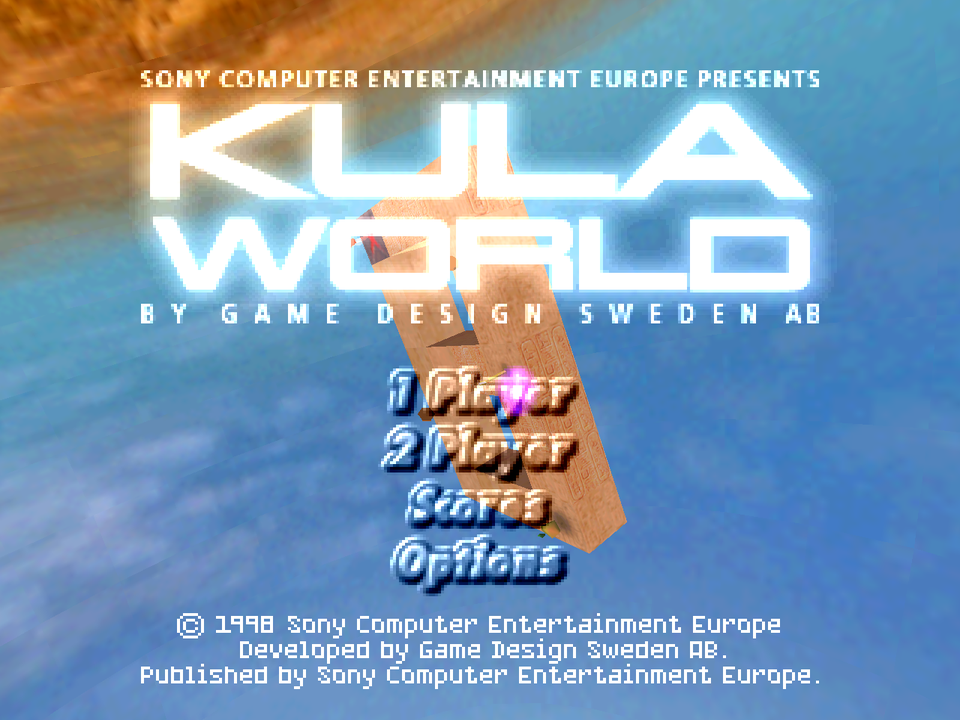

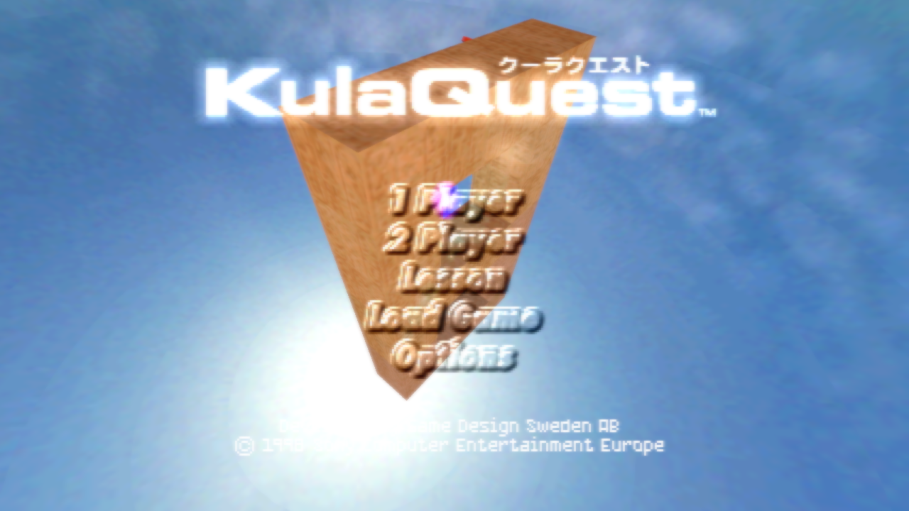

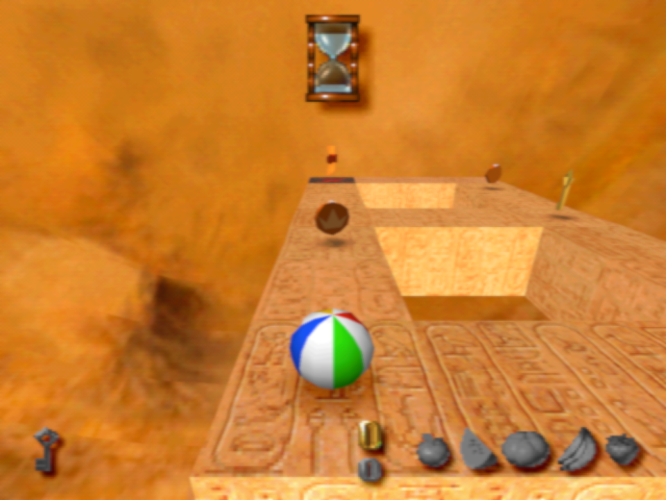

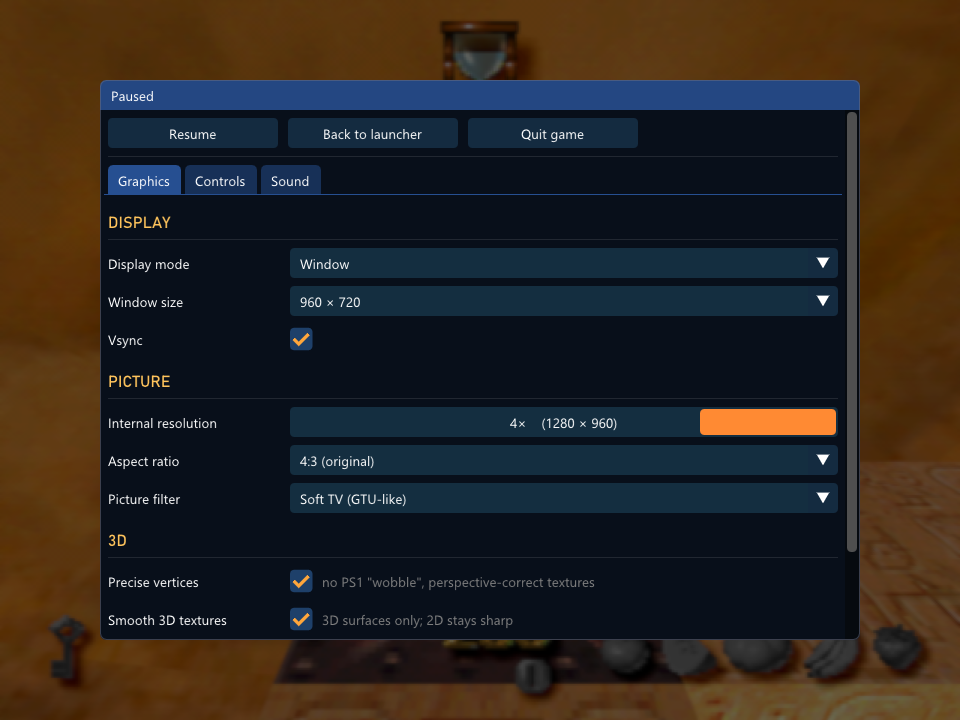

*In-game pictures: Roll Away, Kula World and KulaQuest running in this port
(4× internal resolution; the first ones with the soft-TV filter). The game's
pictures shown here are © their respective owners.*

## Disclaimer

- **You must own the game.** To play, you need a dump (disc image) of your
  own original *Roll Away (USA)*, *Kula World (Europe)* or *KulaQuest
  (Japan)* disc. This project does not provide, and
  will not help you find, game files.
- **This repository contains no game files:** no code, graphics, sound,
  music, movies, text or data files from the game, and no BIOS. It holds
  this README, the third-party licence list, the source code of the port
  (see [Source code](#source-code)) and pictures: our banner, the launcher
  (our own, with a background drawn by a script), plus the box covers and
  in-game pictures, which are © their respective owners and shown only to
  identify the game.
- **No game assets are distributed.** The release contains the port's own
  program and the licences of the open-source libraries it uses. Every
  graphic, sound, music track, movie and text is read at run time from your
  own disc image. The program is the game's logic recompiled for Windows;
  it holds none of the game's files or data (before every release, the
  program is searched for every part of the disc's files, and none may be
  found).
- *Roll Away*, *Kula World* and *KulaQuest* are trademarks of their
  owners. This is a non-commercial fan project and is not affiliated with
  or endorsed by Psygnosis, Game Design Sweden or Sony.

## Improvements over the original

All of these can be changed under **SETTINGS** (and in the game from the
pause menu).

**Pictures**
- **Higher internal resolution**, up to 4×.
- **Precise vertices**: no PS1 "wobble", perspective-correct textures.
- **True colour**: smooth shading and transparency in 8 bits per colour,
  without the console's dithering pattern.
- **Detailed distant textures** (on by default): sharp track blocks all
  the way to the horizon. To save video memory the PS1 game draws every
  block beyond a short distance with a small copy of its texture, a quarter
  of the size and only 16 colours, so at a higher resolution the track
  ahead turns into blurred, washed-out squares a few metres from the ball.
  The port recognises each small copy by its content, finds the full-size
  texture it was made from, and draws that instead, so the hieroglyphs,
  patterns and the shadows of the fruit, coins and keys under them stay as
  detailed far away as up close. The game's own darkening with distance is
  kept. Nothing is added to the game: only its own full-size textures are
  used. See the comparison below.
- **Picture filters**: sharp pixels, bilinear, a soft-TV filter (GTU-like)
  and four CRT looks: *CRT* (scanlines, mask, curvature), *Soft CRT* (a TV:
  the whole picture softened, HUD and text too, with soft scanlines and a
  glow), *Composite CRT* (colour bleed as on a composite cable) and *PVM*
  (a studio monitor: sharp scanlines). A **filter strength** slider tunes
  how much of the TV and CRT filters shows, from the full look down to the
  plain picture.
- **Widescreen (16:9)**, optional: the 3D world is seen wider and keeps its
  proportions, the menus and the HUD keep theirs too (screens of only 2D,
  and the movies, are shown 4:3).
- **Window or borderless full screen**, any window size, 4:3, 16:9 or
  stretched, vsync.

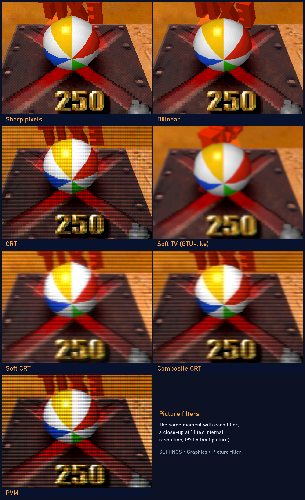

*The same moment with each picture filter, a close-up at 1:1 (4× internal
resolution, a 1920 × 1440 picture). The game's picture is © its
respective owners.*

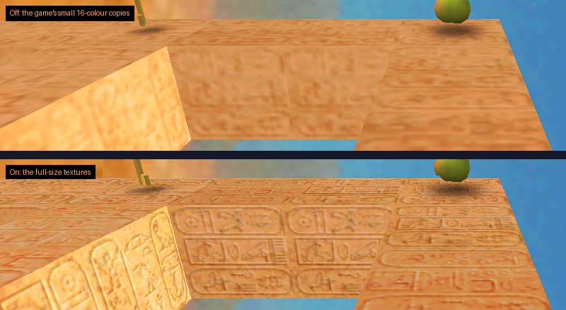

*Detailed distant textures, off (above) and on (below): the same moment, a
1:1 close-up at 4× internal resolution. The game's picture is © its
respective owners.*

**Sound**
- **Separate volumes** for the music (the disc's XA tracks) and the sound
  effects.

**Comfort**
- **Save after every level** (optional, under GAME): the game offers its
  save point after each level, not only every fifth.
- **Pause menu** with Select + Start (or F1): resume, back to the launcher,
  quit the game, and every setting.
- **Fast forward**: hold Tab.
- **No loading pauses**: files are read at once (music and movies still
  stream in real time, as on the console).
- **Launcher**: a resizable splash window that remembers its size; choose
  the disc and have it checked (the title then shows the release: Roll
  Away, Kula World or KulaQuest), change every setting, with mouse,
  keyboard or controller.
- **Controls**: keyboard or XInput controllers (Xbox and compatible), two
  players, every button remappable, automatic mapping.
- **Disc images**: `.bin`/`.cue`, `.chd` (compressed) and `.iso`.
- **Memory card in a file**: `roll_away_card1.mcd` next to the program, in
  the raw format emulators use. No BIOS needed.

## Level editor

Make your own levels: `roll_away_editor.exe` (**LEVEL EDITOR** in the
launcher) is a 3D level editor.

- **Blocks snap together**: click the side of a block and the new block
  sits right there; drag to build a row, a floor or a wall.
- **Everything the game has**: normal, fire, ice, invisible and acid
  blocks, moving, crumbling and flashing blocks, lasers, and on the blocks
  the start, keys, the exit, coins, gems, fruit, power-ups, spikes,
  patches, bounce pads, arrows, transporters, buttons and enemies.
- **The game's rules** are checked while you build: one start, things
  only on open sides, the exit opens when all keys are taken.
- **Normal or bonus level**: a normal level keeps its world's look (with
  no keys its exit is open at once); a bonus level gets the game's bonus
  look and the BONUS letters.
- **The world's own look**: the editor reads the block textures from your
  disc, and the level is played in the world you choose (its textures, sky
  and music).
- **Play at once**: **Play** (F5) starts the game straight into the level.
  Saved levels (`.rlv`) are played with **PLAY OWN LEVEL** in the launcher
  or by dropping them on its window.
- **Learn from the masters**: File > Open a level of the game opens any of
  the game's levels from your disc.

The game itself is not changed: when you play your own level, the port
serves it in place of the game's levels as they are read from the disc.

## Controls

Plug-and-play with modern controllers!

| PS1 | Keyboard | Controller |
|---|---|---|
| D-pad | Arrow keys | D-pad or left stick |
| Cross | X | A |
| Circle | C | B |
| Square | Z | X |
| Triangle | S | Y |
| L1 / R1 | Q / E | LB / RB |
| L2 / R2 | 1 / 3 | LT / RT |
| Start | Enter | Start |
| Select | Backspace | Back |

Everything can be changed under **SETTINGS → CONTROLS**, also for player 2.

In the game: **Select + Start** (or **F1**) pauses and opens the menu,
**Tab** fast-forwards, **Esc** goes back to the launcher.

## Files

Everything stays in the program's folder:

- `settings.ini`: the settings.
- `roll_away_card1.mcd`: the memory card in slot 1.
- `roll_away.log`: a log for troubleshooting.
- `level_editor.ini`: the level editor's disc, if not the launcher's.

## FAQ

**Do I need a BIOS?** No. Everything the BIOS and Sony's libraries do on a
PlayStation is written anew in the port.

**Where are my saves?** On the memory card file `roll_away_card1.mcd`. It
is the format DuckStation and other emulators use, so a card from an
emulator can be copied in (rename it).

**Which version of the game?** Any of the three: *Roll Away (USA)*,
SLUS-00724; *Kula World (Europe)*, SCES-01000; *KulaQuest (Japan)*,
SCPS-10064. Each release's code is recompiled on its own and the program
holds all three; the launcher sees which disc you chose and runs its code.
Other releases or modified discs are not supported.

**Does Kula World run at 50 Hz?** Yes. The European release is a PAL game
and runs at the PAL rate, as on a European PlayStation; the others run at
60 Hz. *KulaQuest* is Japanese throughout, and confirms with Circle, as on
a Japanese console.

**Can the versions share a memory card?** Yes. Like a real card,
`roll_away_card1.mcd` holds the saves of each release side by side; each
release sees only its own.

**Why is there no music with my .iso?** The music and the movies are XA
sectors, which an `.iso` image does not keep. Use a `.bin`/`.cue` or
`.chd` image.

**Is the source code available?** Yes, in [`source/`](source), and it can
be built: see [Source code](#source-code).

## Source code

The [`source/`](source) folder holds the whole port: the recompiler that
turns the game's MIPS code into C, the run-time that runs it (memory,
interrupts, and Sony's libraries for graphics, the CD-ROM with its XA music
and movie streaming, the movie decoder, controllers, the memory card and
the BIOS written anew), the PlayStation's graphics, geometry, sound and
movie chips in software, the launcher and the window, picture and sound
output, plus the build scripts, the tests and the open-source libraries it
uses.

The game's code is not in the repository. It is recompiled when you build,
from the program on **your own disc** (one or more of the three releases;
the build holds the code of those it was given):

```bat
source\build.bat --disc "D:\Games\Roll Away (USA).chd" --disc "D:\Games\Kula World (Europe).chd"
```

The first build downloads the compiler (llvm-mingw) and ninja; Python 3 is
needed. See [source/README.md](source/README.md).

## Credits

- Built with [Dear ImGui](https://github.com/ocornut/imgui) and
  [libchdr](https://github.com/rtissera/libchdr) (with zstd, LZMA SDK,
  miniz and dr_flac), and [stb_image](https://github.com/nothings/stb).
  Their licences are in [THIRD_PARTY.md](THIRD_PARTY.md) and in the
  `licenses` folder of the release.
